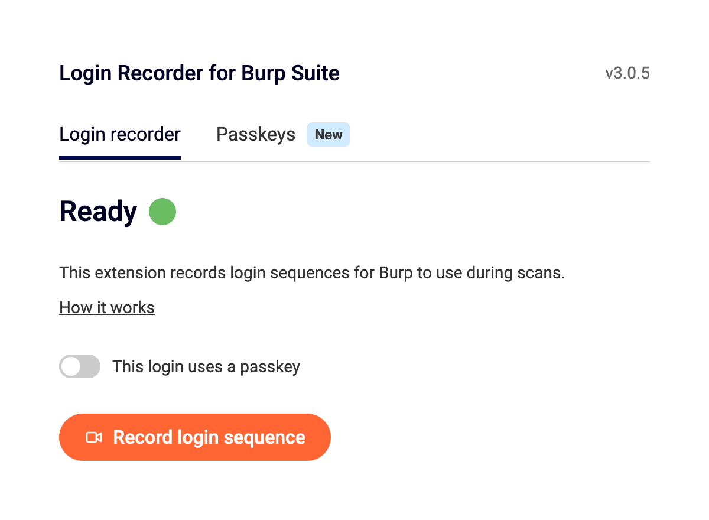

# Login Recorder for Burp Suite — Firefox port

An unofficial Firefox port of PortSwigger's **[Login Recorder for Burp Suite](https://chromewebstore.google.com/detail/login-recorder-for-burp-s/anpapjclbjicacakeoggghfldppbkepg)** Chrome extension (v3.0.5).

It records a login sequence (typing, clicks, navigation, new tabs, iframes and passkeys) in the browser and outputs the JSON script that Burp Suite uses for **recorded login** authentication in scans. The output format is unchanged from the Chrome version.

<p align="center">
  
</p>

> **Disclaimer:** This project is not affiliated with or endorsed by PortSwigger. The original extension, its UI, images and in-page scripts are PortSwigger's work; this repo only adapts them to run on Firefox. If PortSwigger asks for this to be taken down, it will be.

## Original extension

| | |
|---|---|
| Name | Login Recorder for Burp Suite |
| Publisher | PortSwigger |
| Chrome Web Store | https://chromewebstore.google.com/detail/login-recorder-for-burp-s/anpapjclbjicacakeoggghfldppbkepg |
| Extension ID | `anpapjclbjicacakeoggghfldppbkepg` |
| Version ported | 3.0.5 |
| Burp docs | [Recording a login sequence](https://portswigger.net/burp/documentation/scanner/authenticated-scanning/using-recorded-logins#recording-a-login-sequence) |

If you use Chrome or Chromium, install the official extension from the Chrome Web Store instead.

---

## Requirements

- Firefox **128 or newer** (tested on Firefox 158 Developer Edition)
- Burp Suite Professional or Enterprise, to use the recorded login

## Installation

### Option 1: Temporary install (any Firefox, removed on restart)

1. Download or clone this repo:
   ```bash
   git clone https://github.com/Somchandra17/burp-login-recorder-firefox.git
   ```
2. Open `about:debugging#/runtime/this-firefox` in Firefox.
3. Click **Load Temporary Add-on…** and select `manifest.json` in the cloned folder.

### Option 2: Permanent install (Firefox Developer Edition / Nightly / ESR)

Release Firefox only installs Mozilla-signed add-ons. Developer Edition, Nightly and ESR can install unsigned ones:

1. Open `about:config` and set `xpinstall.signatures.required` to `false`.
2. Download `login-recorder-firefox-3.0.5.xpi` from the [latest release](https://github.com/Somchandra17/burp-login-recorder-firefox/releases/latest).
3. Open `about:addons`, click the ⚙ gear → **Install Add-on From File…**, and pick the `.xpi`.

### Option 3: Permanent install on release Firefox (self-signed)

Sign it as an unlisted add-on with your own (free) AMO API keys:

```bash
npx web-ext sign --channel=unlisted --api-key=<JWT issuer> --api-secret=<JWT secret>
```

Then install the signed `.xpi` from `about:addons` as in Option 2. Before signing, change `browser_specific_settings.gecko.id` in `manifest.json` to an ID you own.

### After installing (recommended)

**Allow private windows.** The recorder captures logins in a clean private window, so existing cookies and sessions don't skip the login step.

1. Open `about:addons` → **Login Recorder for Burp Suite**.
2. Set **Run in Private Windows** to **Allow**.

If you skip this, the popup shows a *Finish setup* screen. You can choose **Continue without incognito** to record in a normal window instead; if you do, log out of the target first.

**Check site access.** Under the add-on's **Permissions** tab, make sure *Access your data for all websites* is enabled. The recorder needs it to run on the target site.

## Usage

1. Click the toolbar icon → **Record login sequence**. A new (private) window opens.
2. Go to your target's login page and log in as normal. The page gets a red border while it's being recorded.
3. Click the toolbar icon in the recording window → **Stop recording**, or just close the recording window.
4. The script is copied to your clipboard. You can also copy it again with **Copy script** in the popup.
5. Paste it into Burp under **Scan configuration → Authentication → Recorded login sequences**.

### Passkey logins

1. In the popup, turn on **This login uses a passkey** → **Add passkey** → **Capture new passkey**.
2. Create a passkey on the target site in Firefox. The extension's software authenticator captures it, and a *Passkey captured* toast appears.
3. Record the login sequence as normal. The passkey is embedded in the recording.
4. Use **Export** in the Passkeys tab to save a passkey for later sessions, and **Import passkey** to load it again. In Firefox, import opens the UI in a tab, because the toolbar popup closes when a file picker opens.

Captured passkeys only last for the browser session unless you export them.

## Building the `.xpi`

```bash
cd burp-login-recorder-firefox
zip -r -X ../login-recorder-firefox.xpi . -x "*.git*" "*.DS_Store"
# or
npx web-ext build
```

Lint with `npx web-ext lint`.

## What changed from the Chrome version

See [PORTING-NOTES.md](PORTING-NOTES.md) for how the extension works and the full list of changes. In short:

- The MV3 service worker became a Firefox event page with the same logic, now readable (`background/background.js`).
- The Chrome offscreen-document clipboard workaround was replaced by direct clipboard writes.
- Only `passwordSavingEnabled` is toggled, because Firefox doesn't expose the autofill privacy settings to extensions.
- Popup: the `chrome://extensions` link became an `about:addons` hint, and passkey import moved to a tab.
- `Recorder.js` and the WebAuthn shim are byte-identical to the original.

## Known differences and limitations

- Firefox frame IDs are large numbers (for example `23622320129`) rather than Chrome's small integers. They are consistent within a recording.
- Not yet verified: private-window recording mode, `goto` events from typing in the address bar, the HTTP platform-auth warning, and importing recordings into Burp. Issue reports are welcome.
